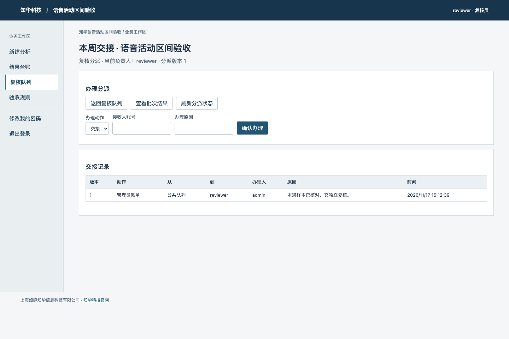
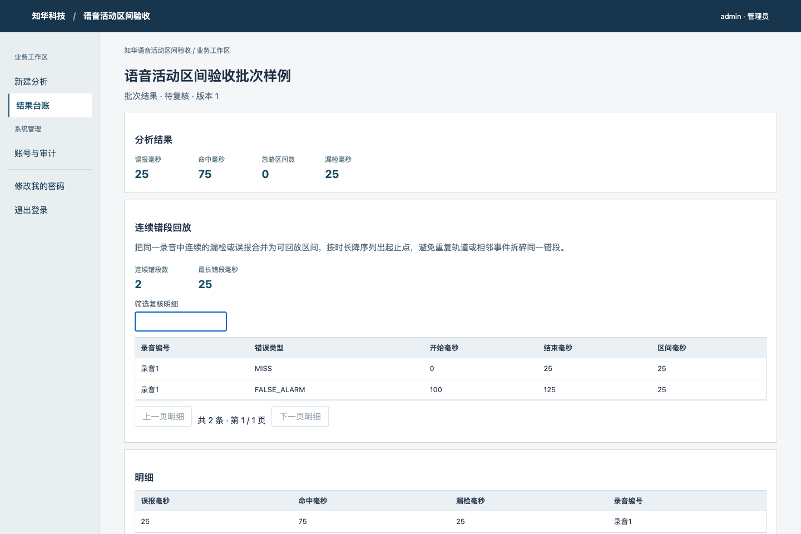

# ZhuaTech VAD Timeline

**1.4.1 – shift handover and offline review.** Filter work by time waiting and continue from the last item even if a colleague completes earlier jobs. Print a local bilingual report using the [included Python tool](scripts/render_scenario.py). Give it the exported evidence ZIP, an independently obtained SHA-256 and the scenario JSON; exact source bytes are checked. Raw examples and reviewer notes are excluded. [Workflow and command](docs/ROUTING-AND-SCENARIOS.md).

**1.4 – review ownership and fixed-input scenarios.** Claim unassigned work, assign it to an eligible independent reviewer, hand it off, or return it to the queue. A departed reviewer's items remain visible for reassignment. In a batch detail, compare up to three configurations on the exact same sample rows; the archived result and the recalculated reference are separate. Preview never alters an official record. [Worked scenario](examples/scenario.json) · [API and review workflow](docs/ROUTING-AND-SCENARIOS.md).

**1.3 – Duration-weighted quality.** Reports micro duration-weighted precision, recall, F1 and IoU, plus per-recording evidence; silence is not counted as a correct speech prediction. [Worked diagnostic](examples/diagnostics-expected.json).

Administrators can preview proposed thresholds against 1–10 recent snapshots before publishing. Reviewers can compare two batches down to keyed result rows; passing a failed or indeterminate gate needs an independent exception reason. Older snapshots are never rescored. Download a single batch’s evidence ZIP and run `python3 scripts/verify-evidence.py evidence.zip --sha256 TRUSTED_DIGEST` offline. The checksum detects changes but is not a digital signature. [Policy example](examples/acceptance-policy.json) · [Workflow and endpoints](docs/OPERATIONS.md#acceptance).

**1.3.2 – revision-safe evidence.** Linking a correction increments the original record’s revision without changing its input, result or decision. An export from a stale screen is refused; refresh and inspect the successor before downloading. Retrying the identical correction returns the same record. Export and correction are ordered per batch even when requested simultaneously; read-only screens do not lock the reviewer out.

For existing installations, set `WORKSPACE_REQUIRE_EXISTING=TRUE` before switching databases. A foreign or incomplete project schema is refused before migrations. The MySQL 8.4 [logical backup procedure](docs/OPERATIONS.md#mysql-recovery) needs only read access to application tables, preserves review evidence, and excludes active sessions. A checksum is not encryption; keep the SQL dump private.

**1.2 – traceable resubmission.** The original submitter can correct a rejected or withdrawn batch, explain what changed, and send it for independent review. The application recomputes the result as a new record, keeps both snapshots, and shows field-level differences. [Worked example](examples/correction.json) · [Workflow and API](docs/OPERATIONS.md#corrections).

**1.1 – investigation report.** Merge consecutive missed or false-alarm segments into a duration-ranked playback list. Saved 1.0 snapshots remain unchanged; copy and rerun to generate a new report.

Sweep overlapping speech intervals per recording and report missed, false-alarm and correctly detected durations.

[简体中文](README.md) · Independent batch workbench inspired by [pyannote/pyannote-audio](https://github.com/pyannote/pyannote-audio).

Import the [acceptance batch](examples/acceptance.json), run the calculation and compare its row evidence and summary against the [expected result](examples/expected.json). Operators submit records, a different reviewer signs off, and administrators manage accounts and audit events. No external model keys required.

Use JDK 21 and run `bash scripts/start.sh --build` or `scripts\start.cmd --build` on Windows. Set your own initial admin password, then visit http://127.0.0.1:19445. Local H2 persists across restarts. Use MySQL with a dedicated schema, HTTPS and independently managed secrets for production. Maximum 200 rows per batch. See [operations](docs/OPERATIONS.md) and [tests](docs/TESTING.md).

Shanghai Rujing Zhihua Information Technology Co., Ltd. · [English website](https://www.zhuatech.cn/en.html). [Source-available license](LICENSE): personal non-commercial learning only. Commercial use requires written permission. [han@zhuatech.cn](mailto:han@zhuatech.cn) · [jack@zhuatech.cn](mailto:jack@zhuatech.cn) · [WhatsApp +86 17521234993](https://wa.me/8617521234993)
