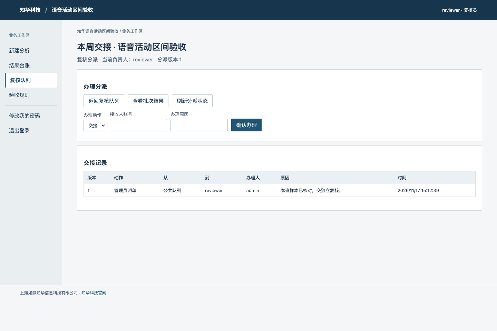
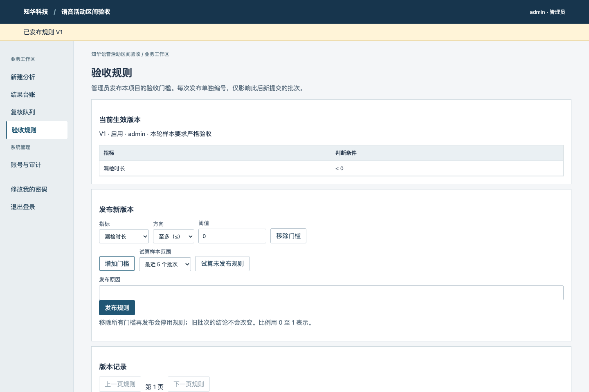
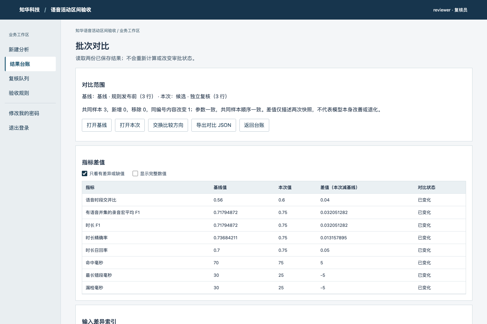
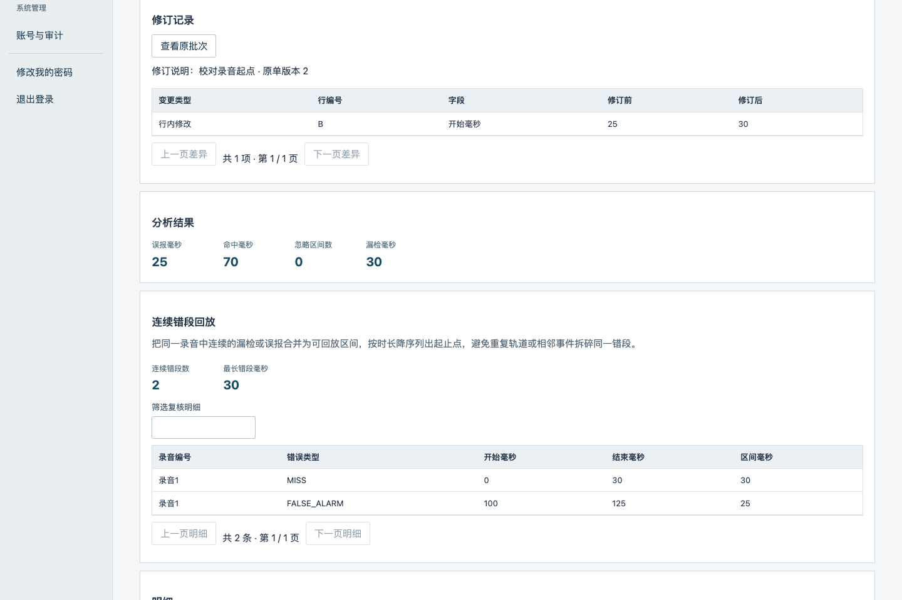
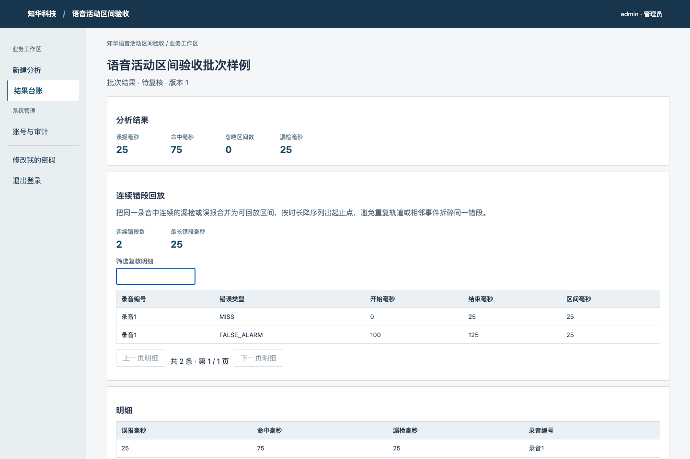
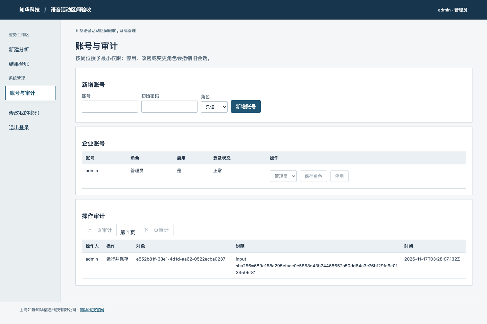
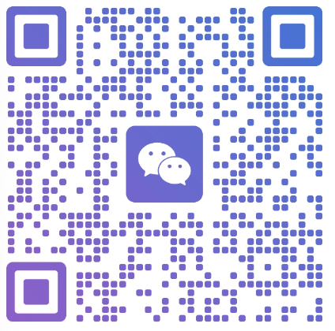

# 知华语音活动区间验收

[English](README.en.md) · Java 21 / Spring Boot / MySQL 8.4 / 响应式 H5

分录音扫描标注与检测区间，合并重叠后累计命中、漏检和误报毫秒。

**什么时候用：** 接收时间戳，不上传或识别音频；不评价说话人身份。短于阈值的区间不参与计分。 业务员提交一个批次，系统保存输入和逐行证据；另一名复核员通过或退回，管理员可追查操作记录。

## 1.4：复核分派与固定样本试算

值班时可以按等待时长筛选，并连续翻页处理积压单。要交给同事复核试算结果，可用随包的[离线评审工具](scripts/render_scenario.py)将已核对来源的试算与证据生成中英文 HTML；默认不列原始样本或审批意见。[使用方法](docs/ROUTING-AND-SCENARIOS.md#值班翻页与离线评审)。

在「复核队列」领取、派单、交接或释放待办。已指定负责人的批次仅由该负责人复核；负责人停用或转岗后，管理员可以重新分派。分派单独留痕，不改变原始分析证据。

在批次详情打开「业务参数试算」，最多比较三个参数方案。例如「忽略不足 101 毫秒的片段」，按[本项目固定样例](examples/scenario.json)可核对 `ignored`。归档值、原参重算和方案结果分别显示；不新建批次、不覆盖证据。详见[接口与岗位流程](docs/ROUTING-AND-SCENARIOS.md)。

## 1.3：按语音时长评估与独立验收

按时间并集而不是片段数量计算微平均精确率、召回率、F1 和语音交并比。每段录音独立给出结果，分母为零时显示无法估计，不把静音时长算作正确命中。

1. 管理员在「验收规则」编辑门槛，可先用最近 1–10 个已保存批次试算。试算不改原记录，发布才生效。[本项目规则示例](examples/acceptance-policy.json)不是默认标准，需按业务确认。
2. 在台账设定基线，再选择另一批次比较。先核对样本和参数是否一致，再看指标和逐条结果；没有保存的历史证据不会按零计算。
3. 未达标或无法判定的批次须由另一位复核人说明例外依据才能通过。详情可下载 ZIP，用随包脚本离线校验，便于交接。[样例诊断指标](examples/diagnostics-expected.json) · [操作与接口](docs/OPERATIONS.md#acceptance)
4. 别人打开了旧版原单时，后续修订会使旧证据导出失效。点击「刷新原单并核对版本」可查看修订关系，再决定是否下载。 同时发起修订和证据导出时，按单据顺序处理；浏览详情不会锁住复核操作。

升级已有库时可启用“仅打开已有库”保护。MySQL 逻辑备份仅需源库只读权限，恢复副本不会沿用原库登录会话，操作方式见[部署与恢复](docs/OPERATIONS.md#mysql-recovery)。

## 1.2：修订后重新送审

以「校对录音起点」为例：原提交人在退回或撤回的详情点「发起修订」，修正业务输入并填写原因。系统重算结果并另建待审批次，列出字段的前后值。原单保留，不可自审。普通「复制为新批次」仍可用于独立实验，不记录修订关系。[本项目修订样例](examples/correction.json) · [操作与升级说明](docs/OPERATIONS.md#corrections)

## 先验证一个真实结果

打开「新建分析」→「载入示例」→「运行并保存」。本项目的[输入](examples/batch.json)应该得到以下关键指标：命中毫秒 = 75、漏检毫秒 = 25、误报毫秒 = 25。[明细预期](examples/expected.json)可用于二次开发回归。

## 从源码启动

准备完整 JDK 21，在项目根目录运行 `bash scripts/start.sh --build`（Windows：`scripts\start.cmd --build`）；首次构建需要联网。按控制台提示设置管理员密码；无交互终端应通过安全环境变量 `ADMIN_PASSWORD` 提供，至少 12 个字符。浏览器打开 [本地工作台](http://127.0.0.1:19445)，账号 `admin`。没有内置密码，不需要 GPU 或模型密钥。本地 H2 保存到本工程的 var 目录；可用 `PORT` 指定其他端口。

## 1.1 新功能：连续错段回放

把同一录音中连续的漏检或误报合并为可回放区间，按时长降序列出起止点，避免重复轨道或相邻事件拆碎同一错段。 复核明细可检索、分页；完整 JSON 中新增 `inspection`。旧批次按原快照展示，复制并重新提交才生成新报告。

## 部门使用与部署

每行是一段左闭右开时间区间，`track` 选 reference 或 detected；`recording` 跨录音分别计分。同一轨道重叠不重复累计；无标注但检测到的时间算误报。

管理员创建业务员、复核员及只读账号；页面支持批次 JSON 导入、查询分页、结果下载、撤回及版本校验。默认一个企业一个实例；生产用独立 MySQL schema、外置密码、HTTPS 入口及备份。批次上限 200 行，不提供多节点容量承诺。[部署、操作、权限及 API](docs/OPERATIONS.md) · [验收方法](docs/TESTING.md)。

## 参考与许可

方向参考 [pyannote/pyannote-audio](https://github.com/pyannote/pyannote-audio)。本系统独立实现上述业务，不是上游分支。上海如静知华信息科技有限公司（知华科技）· [官方网站](https://www.zhuatech.cn/)。依照[个人学习交流许可](LICENSE)公开源码，非 OSI 开源许可。企业生产、商业使用或客户交付须另获书面授权。商业授权或定制开发请微信添加微信号zhuatech或zhuatech2进行咨询。

| 微信 zhuatech | 微信 zhuatech2 |
|---|---|
|  |  |
